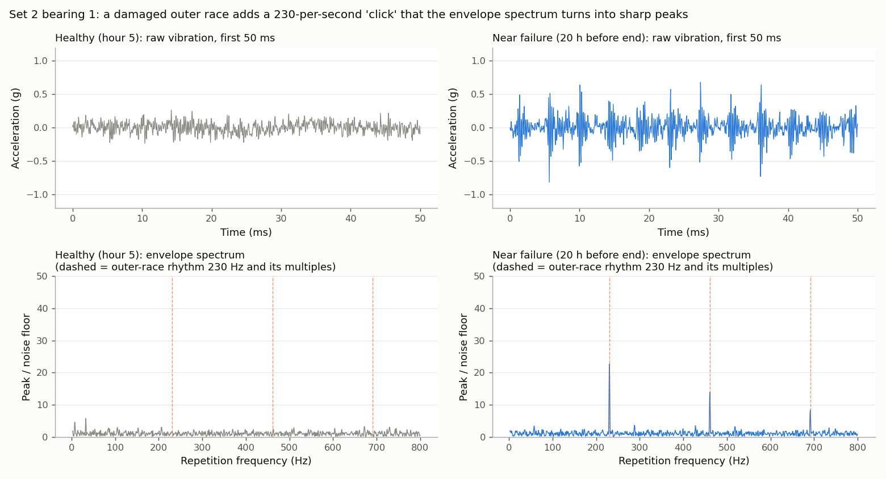
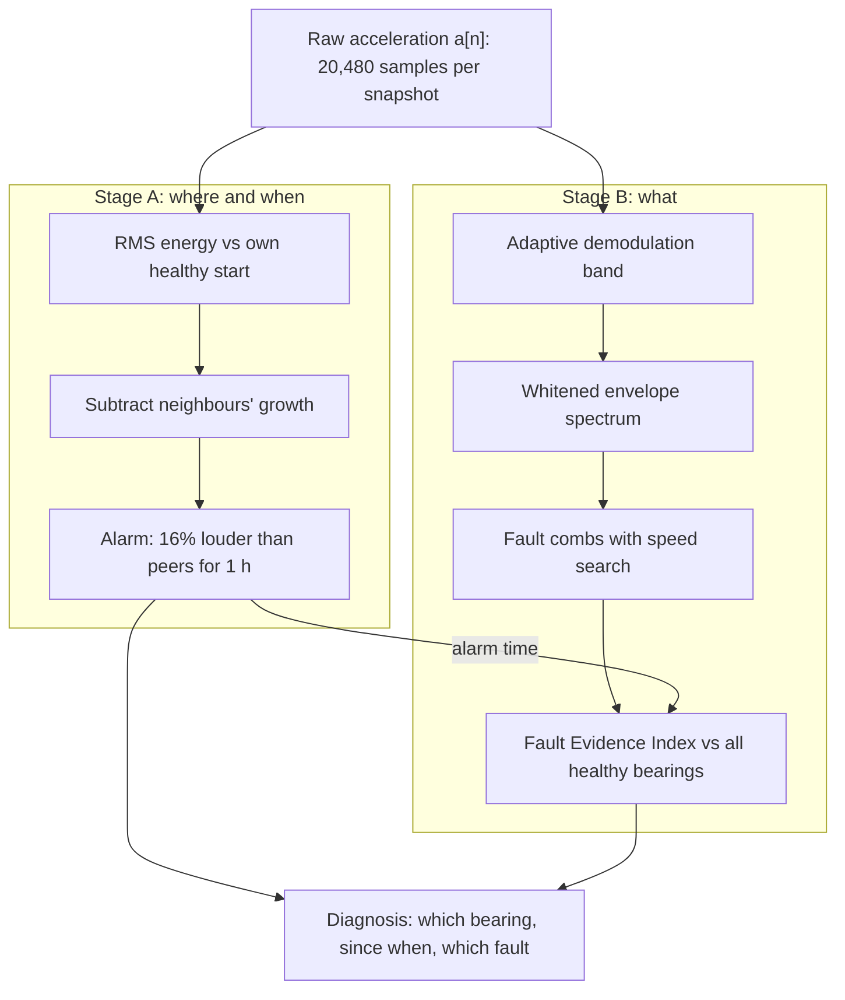
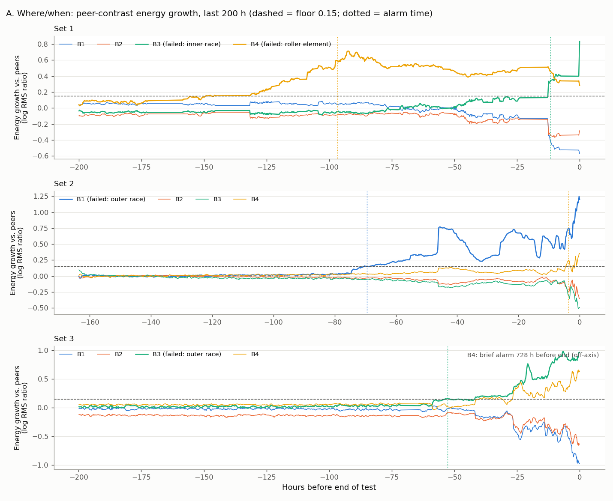
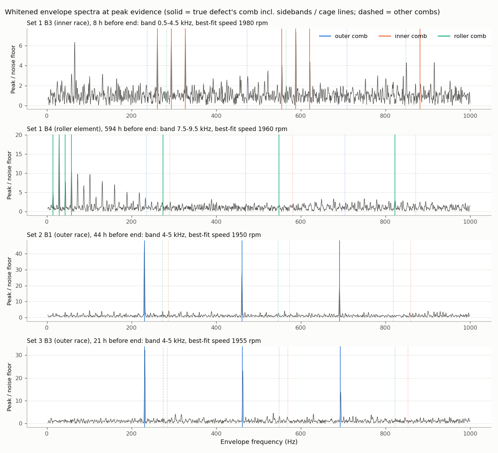
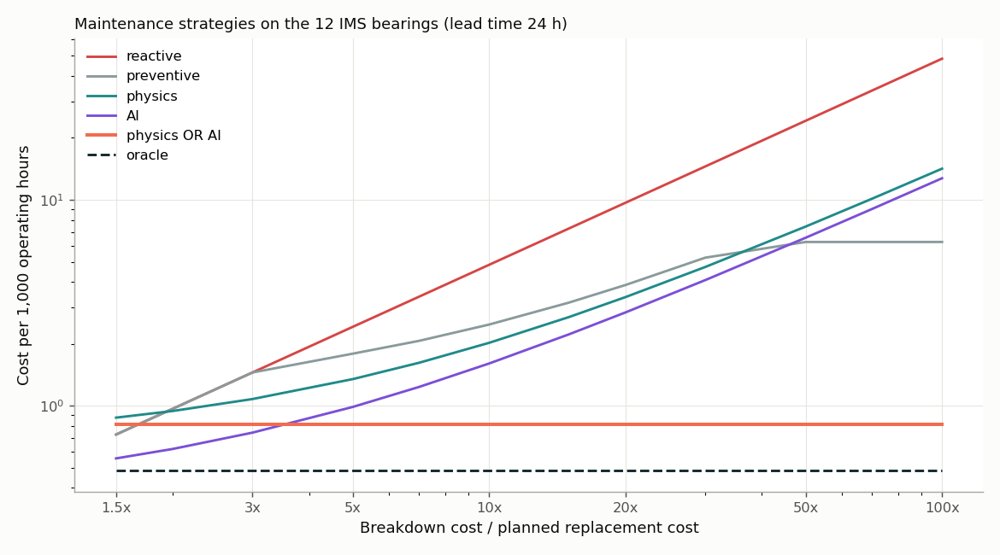

# Bearing Fault Diagnosis and Predictive Maintenance on the NASA/IMS Dataset

Team course project on fault diagnosis (Part I) and predictive maintenance (Part II) for smart factories, using the NASA/IMS run-to-failure bearing dataset.

**Part I result in one line:** a two-stage, training-free method finds all 4 bearing failures in the dataset, a median of **61 hours** before the end of the test, and names every fault type correctly. Its margin between the true fault and the strongest wrong one is at least **2.7×**; the standard fixed-band method drops to **1.03×**, a coin flip.

---

## Contents

1. [Project at a glance](#1-project-at-a-glance)
2. [Repository layout](#2-repository-layout)
3. [Setup](#3-setup)
4. [Part I: fault diagnosis](#4-part-i-fault-diagnosis)
5. [Optional: deep-learning variant](#5-optional-deep-learning-variant)
6. [Part II: predictive maintenance](#6-part-ii-predictive-maintenance)
7. [How to reproduce everything](#7-how-to-reproduce-everything)
8. [Limitations](#8-limitations)
9. [Abbreviations](#9-abbreviations)

---

## 1. Project at a glance

| | Part I: Fault diagnosis | Part II: Predictive maintenance |
| --- | --- | --- |
| Question | When did a bearing start failing, which one, and what part is damaged? | Which maintenance strategy, and what does condition monitoring buy? |
| Approach | Signal processing + robust statistics, no training | Strategy comparison: reactive, preventive, condition-based (physics / AI) |
| Labels needed | None | None for the strategies; run-to-failure histories for the RUL attempts |
| Main scripts | `diag_features.py`, `diagnosis.py` | `maintenance.py` (+ `rul.py`, `rul_bound.py`) |
| Status | Done, evaluated on all 12 bearings | Done, evaluated on all 12 bearings |

Course brief: [guide.txt](guide.txt). Part I does not require AI/ML; practical implementation on a dataset counts toward "Technical Depth & Application".

---

## 2. Repository layout

```
NasaDataset/
├── README.md                              ← this file
├── guide.txt                              ← course assignment brief
├── Readme Document for IMS Bearing Data.pdf  ← official dataset description
├── fault_diagnosis_explained.md           ← Part I explained simply (Feynman style, with figures)
├── fault_diagnosis_part1_short.pptx       ← 11-slide Part I presentation
├── fault_diagnosis_presentation.pptx      ← 22-slide full deck (Part I + deep-learning variant)
├── predictive_maintenance_part2.pptx      ← 8-slide Part II presentation (maintenance decisions)
├── 1st_test/ 2nd_test/ 3rd_test/          ← raw data (not in git, ~6 GB, see Setup)
└── pipeline/
    ├── common.py          shared loading, dead-snapshot removal, failed-run list
    ├── features.py        raw files → time/frequency/envelope features per snapshot
    ├── plots.py           RMS and kurtosis trends per test
    ├── diag_features.py   Part I signal stage: adaptive band, envelope spectrum, fault combs
    ├── diagnosis.py       Part I decision stage: detection, identification, comparison, figures
    ├── explain_figure.py  teaching figure: healthy vs failing signal
    ├── dl_spectra.py      deep-learning variant: envelope spectra as network input
    ├── dl_diagnosis.py    deep-learning variant: autoencoder + CNNs
    ├── rul.py             Part II: RUL models
    ├── maintenance.py     Part II: maintenance strategy comparison (cost, lead-time sweep)
    ├── rul_bound.py       Part II experiment: conformal RUL bound vs act-at-alarm (negative result)
    └── outputs/           all CSVs and figures (the .npy arrays are not in git)
```

---

## 3. Setup

### 3.1 Data

Download the **IMS Bearings** dataset from the [NASA Prognostics Center of Excellence data repository](https://www.nasa.gov/intelligent-systems-division/discovery-and-systems-health/pcoe/pcoe-data-set-repository/) and extract it into the project root so the files sit here:

| Test | Folder | Files | Channels |
| --- | --- | --- | --- |
| Set 1 | `1st_test/1st_test/` | 2,156 | 8 (x and y per bearing) |
| Set 2 | `2nd_test/2nd_test/` | 984 | 4 (one per bearing) |
| Set 3 | `3rd_test/4th_test/txt/` | 6,324 | 4 (one per bearing) |

Each file is a 1-second snapshot: 20,480 rows (20 kHz sampling) × one column per accelerometer, recorded about every 10 minutes. The file name is its timestamp (`2004.02.12.10.32.39`). Paths are set in `SETS` in [pipeline/features.py](pipeline/features.py).

### 3.2 Environment

Tested with Python 3.13 on Linux (CPU only):

```bash
pip install numpy scipy pandas scikit-learn matplotlib   # Parts I and II
pip install torch                                        # only for the deep-learning variant
```

Versions used: NumPy 2.3, SciPy 1.17, pandas 3.0, scikit-learn 1.9, Matplotlib 3.10, PyTorch 2.11.

---

## 4. Part I: fault diagnosis

### 4.1 Problem

Rolling-element bearings sit in nearly every motor, pump, fan and spindle in a factory. We want to answer three questions from vibration alone, **without any recorded fault examples** (real failures are rare):

1. **When** did the bearing stop being healthy? (detection)
2. **Where** is the fault: which bearing on the shaft? (localization)
3. **What** is broken: outer race, inner race or rolling element? (identification)

### 4.2 Dataset

Four Rexnord ZA-2115 bearings on one shaft, nominal 2,000 rpm, constant radial load, run until failure:

| Test | Duration | Failed bearing | Fault (ground truth) |
| --- | --- | --- | --- |
| Set 1 | 828 h | B3 | Inner race |
| Set 1 | 828 h | B4 | Rolling element |
| Set 2 | 164 h | B1 | Outer race |
| Set 3 | 1,073 h | B3 | Outer race |

That gives **4 failed bearings to find** and **8 healthy bearings that must not be flagged**. Three snapshots recorded after the rig stopped (near-zero RMS) are dropped.

### 4.3 Key physics: each fault "clicks" at its own rhythm

When a roller passes over a crack it makes a tiny impact. The impact rate depends on which part is cracked:

| Damaged part | Rhythm | At 2,000 rpm | Order (× shaft speed) |
| --- | --- | --- | --- |
| Outer race | BPFO | 236.4 Hz | 7.092 |
| Inner race | BPFI | 296.9 Hz | 8.908 |
| Rolling element | 2BSF | 279.8 Hz | 8.394 |
| Cage | FTF | 14.8 Hz | 0.443 |

The **envelope spectrum** reveals these rhythms. Band-pass the signal around the frequency where the housing rings, trace the outline of the impact bursts (Hilbert envelope), then take its FFT. Repeating clicks become sharp peaks.



### 4.4 What the data showed (and why the textbook method struggles)

1. **The rig runs about 2.5% slow.** The outer-race peak sits at 230 Hz, not 236.4 Hz, so catalogue frequencies miss the real lines.
2. **Every sensor hears the failing bearing.** The four bearings share one shaft and housing, so a fault's rhythm appears on all four sensors. Rhythm tells *what*, not *where*.
3. **Some faults are visible from the start.** Set 2 B1's outer-race line appears in its first hours, and set 1 B4's cage rhythm 594 h before failure. Comparing a bearing with its own early data hides these faults.

### 4.5 Proposed method



**Stage A, detection and localization (energy).** For each bearing *b*, computed from the raw acceleration `a[n]`:

```
RMS  = sqrt( (1/N) · Σ a[n]² )                          vibration energy, N = 20,480
HI_b = log( RMS_b / median RMS_b in its first 20% )     Health Index (growth)
C_b  = HI_b − median of the other bearings' HI          Contrast vs peers
alarm when C_b > max(8 robust SD of healthy C_b, 0.15) for 6 snapshots (~1 h)
```

Subtracting the peers cancels anything that affects the whole rig (load, temperature, cross-talk).

**Stage B, identification (rhythm).** Per snapshot and sensor ([pipeline/diag_features.py](pipeline/diag_features.py)):

1. **Adaptive band.** Try 28 bands (1, 2 and 4 kHz wide, 0.5-9.75 kHz, plus fixed 1-9 kHz). Keep the one whose envelope spectrum is spikiest, which rewards periodic impacts over single random spikes.
2. **Whitened envelope spectrum.** `E(f) = |FFT(e[n]²)|`, divided by its 20 Hz running median, so each peak is measured against local noise.
3. **Fault combs with speed search.** Score each fault's lines over a speed scale of 0.95-1.01 × nominal and keep the best fit:

    | Comb | Lines | Why |
    | --- | --- | --- |
    | Outer race | 1-3 × BPFO | stationary race, evenly spaced impacts |
    | Inner race | 1-3 × BPFI, ± shaft-speed sidebands | the crack turns with the shaft |
    | Rolling element | 1-3 × 2BSF, 1-4 × FTF | the damaged roller travels with the cage |

4. **Fleet reference.** Robust z-score against the pooled healthy window of *all* sensors in the test: `FEI = (score − median) / (1.4826 · MAD)`.
5. **Verdict.** The fault with the highest mean FEI from the Stage A alarm onward. If none reaches 1, the verdict is "unspecified".

### 4.6 Results

**Detection (all 12 bearings):**

| Method | Failures detected | False alarms (8 healthy) | Median warning |
| --- | --- | --- | --- |
| **Peer-contrast energy (proposed)** | **4 / 4** | **2 / 8** | **61 h** |
| Own-history energy (no peer contrast) | 3 / 4 | 7 / 8 | 58 h |



**Identification (4 failed bearings):**

| Bearing | Truth | Alarm (h before end) | Proposed verdict |
| --- | --- | --- | --- |
| Set 1 B4 | Rolling element | 96.7 | Rolling element ✔ |
| Set 2 B1 | Outer race | 69.5 | Outer race ✔ |
| Set 3 B3 | Outer race | 52.7 | Outer race ✔ |
| Set 1 B3 | Inner race | 11.7 | Inner race ✔ |

**Separation** (true fault's mean evidence ÷ strongest wrong fault's; 1.0 = coin flip) and ablations:

| Variant | Verdicts correct | Separation, worst | Separation, median |
| --- | --- | --- | --- |
| **Proposed** | **4 / 4** | **2.68** | **6.86** |
| Without speed search | 1 / 4 | 0.31 | 1.52 |
| Own-history reference instead of fleet | 3 / 4 | 0.28 | 6.46 |
| Baseline: fixed 1-9 kHz band, catalogue frequencies, raw amplitudes | 4 / 4 | 1.03 | 1.46 |

The baseline also names all four, but twice by a 3% margin. Removing the speed search or the fleet reference breaks the method.



Full tables: `pipeline/outputs/diag_summary.csv` (per bearing) and `pipeline/outputs/diag_comparison.csv` (per variant).

### 4.7 Where to read more

- [fault_diagnosis_explained.md](fault_diagnosis_explained.md): the whole Part I story in plain language, with analogies and every abbreviation explained.
- [fault_diagnosis_part1_short.pptx](fault_diagnosis_part1_short.pptx): 11-slide presentation with large native charts and speaker notes.
- [fault_diagnosis_presentation.pptx](fault_diagnosis_presentation.pptx): 22-slide full deck including the deep-learning variant.

---

## 5. Optional: deep-learning variant

Features are fed to neural networks instead of hand-designed scores ([pipeline/dl_diagnosis.py](pipeline/dl_diagnosis.py)). The dataset has only one inner-race and one rolling-element failure, so the networks are designed around that:

| Design | Input | Labels | Result |
| --- | --- | --- | --- |
| D1: Autoencoder + peer contrast (detection) | 16 condition features | none (healthy data only) | 3/4 detected, **0/8 false alarms**, median 71 h warning |
| D2: 1D CNN trained on **synthetic** faults (identification) | envelope spectrum, 1,024 bins | none (faults simulated on real healthy spectra from the other tests) | 3/4 correct (roller left "unspecified"), no fault calls on healthy bearings |
| D3: 1D CNN supervised on real labels, leave-one-run-out | envelope spectrum | real | 2/4 correct: cannot name a fault type it never saw |

Takeaway: with 4 failures, a network cannot learn rare faults from real labels, but physics-based simulation recovers most of the performance. The physics method (Stage B) remains the most complete at 4/4. Results: `pipeline/outputs/dl_comparison.csv`, `dl_summary.csv`, `dl_*.png`.

---

## 6. Part II: predictive maintenance

**Question:** which maintenance strategy should a factory run on these bearings, and what does condition monitoring (physics and AI) buy over the classic options?

### 6.1 Strategy comparison

[pipeline/maintenance.py](pipeline/maintenance.py) replays six strategies on the same 12 bearings and scores them by cost per 1,000 operating hours (planned replacement = 1, breakdown = 10; renewal-reward estimate, each bearing one cycle). Condition-based strategies replace the bearing 24 h (lead time) after their alarm; if it breaks first, that counts as a breakdown, and an alarm on a healthy bearing counts as a needless replacement.

| Strategy | Failures caught | Breakdowns | Needless replacements | Life wasted per catch | Cost / 1,000 h |
| --- | --- | --- | --- | --- | --- |
| Reactive (run to failure) | 0 | 4 | 0 | 0 h | 4.84 |
| Preventive, every 824 h* | 3 | 1 | 5 | 85 h | 2.48 |
| Condition-based, physics alarm (Part I Stage A) | 3 | 1 | 2 | 49 h | 2.03 |
| Condition-based, AI alarm (Part I autoencoder D1) | 3 | 1 | 0 | 57 h | 1.61 |
| Condition-based, physics OR AI | **4** | **0** | 2 | 54 h | **0.82** |
| Oracle (replace just in time) | 4 | 0 | 0 | 0 h | 0.48 |

\*The best fixed interval chosen **with hindsight** on this data (it sits just before set 1 ends), so preventive is shown at its most optimistic.

**Why OR works:** the two detectors fail on different bearings. The autoencoder warns about set 1 B3 (inner race) 71 h ahead, where the physics alarm gives only 12 h; the physics alarm catches set 3 B3, which the autoencoder misses. Both detectors' thresholds were set on these same 12 bearings, so read this as complementarity on a case study, not a tuned optimum.



**Lead time (how fast the crew must act), breakdown cost 10:**

| Lead time | Physics | AI | Physics OR AI |
| --- | --- | --- | --- |
| 4-8 h | 4/4 caught, 0.82 | 3/4, 1.62 | 4/4, 0.83 |
| 12-48 h | 3/4, 2.0 | 3/4, 1.6 | **4/4, 0.8** |
| 72 h | 1/4, 4.36 | 1/4, 3.78 | 1/4, 4.37 |

Condition monitoring pays off only if the bearing can be replaced within about 2 days of the alarm. The AI detector adds value in the 12-48 h window; with a fast crew (≤ 8 h) the physics alarm alone catches everything. Full tables: `maintenance_strategies.csv`, `maintenance_cost_curve.csv`, `maintenance_lead_sweep.csv`.

### 6.2 Predicting hours left (RUL): tried, not reliable with 4 failures

[pipeline/rul.py](pipeline/rul.py) predicts RUL in hours, capped at 100 h, evaluated **leave-one-run-out** over the four failed bearings:

| Model | Idea |
| --- | --- |
| `gbm` | Gradient-boosted trees on baseline-normalised, smoothed features and their 6-hour trends |
| `hi` | Health-indicator extrapolation: fit exponential RMS growth after onset, extrapolate to a failure threshold learned from the other runs |

RMSE (Root Mean Square Error) over the last 100 h of each run, in hours:

| Held-out run | Fault | gbm | hi |
| --- | --- | --- | --- |
| Set 1 B3 | Inner race | 37.3 | 45.6 |
| Set 1 B4 | Rolling element | 50.9 | 49.0 |
| Set 2 B1 | Outer race | 25.7 | 42.9 |
| Set 3 B3 | Outer race | 19.1 | 41.5 |

Two attempts to turn RUL into better maintenance timing failed, and are kept as findings:

- **Calibrated RUL bound** ([pipeline/rul_bound.py](pipeline/rul_bound.py)): a one-sided conformal lower bound on `gbm` (nested leave-one-run-out). Its honest margin is 17-59 h, as wide as the lead time, so after the Part I alarm it fires immediately; across lead times 4-48 h it never beats "act at the alarm" (`rul_bound_sweep.csv`). The data explains why: after the alarm the four bearings lasted 12, 53, 70 and 97 h, too spread for 3 training examples to predict.
- **Zero-shot foundation model** (Chronos-2) on set 2 B1: it forecasts the health index levelling off instead of accelerating, and was worse than both baselines (RMSE 56 h vs 25 h for `gbm`).

---

## 7. How to reproduce everything

Run from the project root. Times are for a 16-core CPU.

```bash
# Shared features (used by Stage A, the baseline and Part II)
python pipeline/features.py          # a few minutes → outputs/features_set{1,2,3}.csv
python pipeline/plots.py             # RMS / kurtosis trend plots

# Part I
python pipeline/diag_features.py     # ~3 min → outputs/diag_scores_set{1,2,3}.csv
python pipeline/diagnosis.py         # <1 min → diag_summary.csv, diag_comparison.csv, figures
python pipeline/explain_figure.py    # teaching figure

# Deep-learning variant (optional)
python pipeline/dl_spectra.py        # ~3 min → outputs/dl_spectra_set*.npy (not in git)
python pipeline/dl_diagnosis.py      # ~70 min on CPU → dl_*.csv, dl_*.png

# Part II
python pipeline/rul.py               # → rul_metrics.csv, rul_predictions.csv, figures
python pipeline/rul_bound.py         # ~1 min → rul_bound_*.csv/png (negative-result experiment)
python pipeline/maintenance.py       # seconds → maintenance_*.csv, maintenance_strategies.png
```

`diagnosis.py` needs `features.py` and `diag_features.py` to have run first; `dl_diagnosis.py` also needs `diagnosis.py`'s inputs and `dl_spectra.py`.

---

## 8. Limitations

- **Only 4 failures.** All thresholds (8 robust SD, 0.15 contrast floor, FEI 1, autoencoder floor 0.5, CNN "unspecified" 0.3) were chosen on this same data. Treat the numbers as a case study, not a validated accuracy.
- **False alarms.** 2 of 8 healthy bearings alarm in Stage A. One comes during the neighbour's final breakdown and inherits its fault label.
- **Late inner-race evidence.** Set 1 B3's rhythm appears only in the last ~12 h.
- **Constant speed assumed per snapshot.** The speed search handles a constant offset; a variable-speed machine would need a tachometer and order tracking.
- **Peer contrast needs peers.** It assumes several similar bearings on one machine, and it weakens if several fail at once.

---

## 9. Abbreviations

| Short | Meaning |
| --- | --- |
| NASA / IMS | National Aeronautics and Space Administration / Center for Intelligent Maintenance Systems (University of Cincinnati) |
| B1-B4 | Bearing 1-4 on the shaft |
| Hz / kHz / rpm | times per second / thousand times per second / revolutions per minute |
| g | acceleration unit, 1 g = 9.81 m/s² |
| RMS | Root Mean Square: vibration energy of a snapshot |
| FFT | Fast Fourier Transform: splits a signal into frequencies |
| BPFO / BPFI | Ball Pass Frequency, Outer / Inner race |
| BSF / 2BSF | Ball Spin Frequency / twice it (a damaged roller hits both races) |
| FTF | Fundamental Train Frequency (cage rotation) |
| HI | Health Index |
| FEI | Fault Evidence Index |
| SD / MAD | Standard Deviation / Median Absolute Deviation |
| RUL / RMSE | Remaining Useful Life / Root Mean Square Error |
| AE / CNN / 1D | Autoencoder / Convolutional Neural Network / one-dimensional |
| LORO | Leave-One-Run-Out evaluation |
