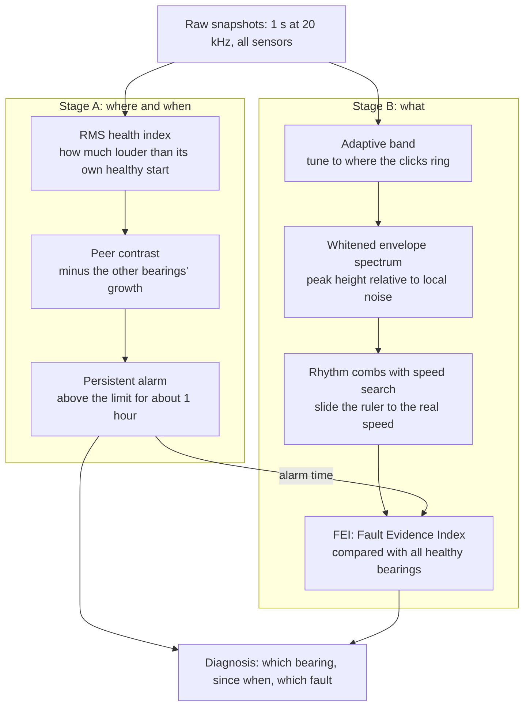
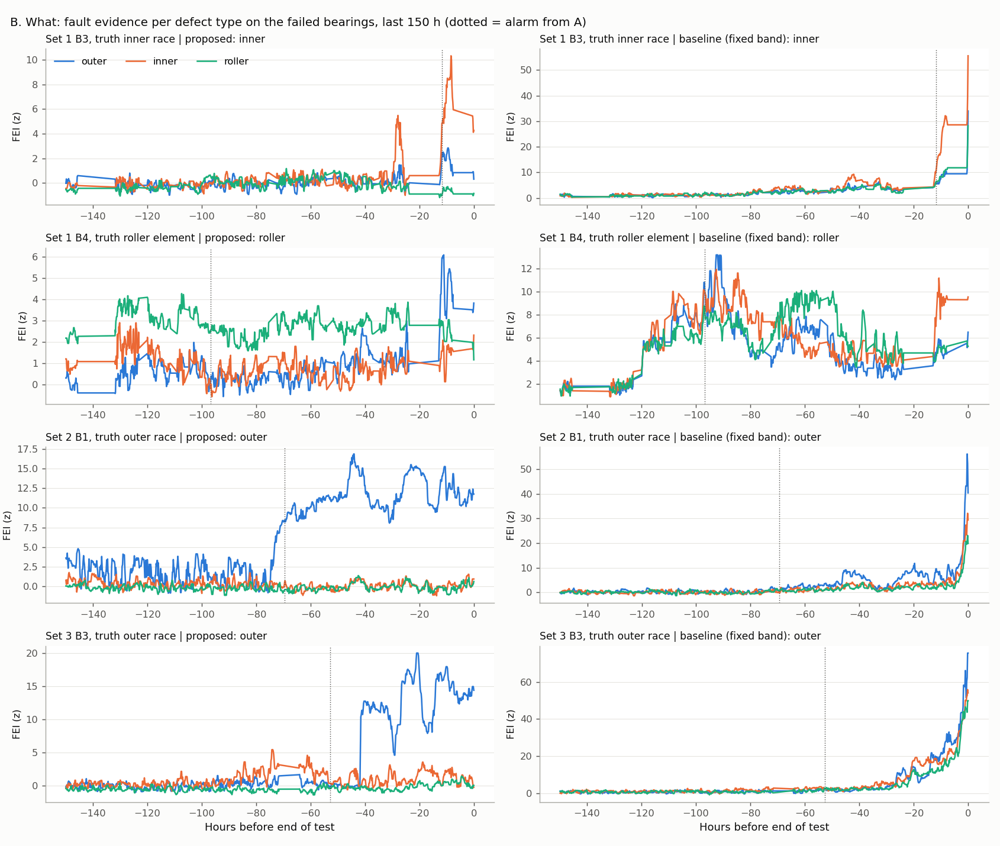
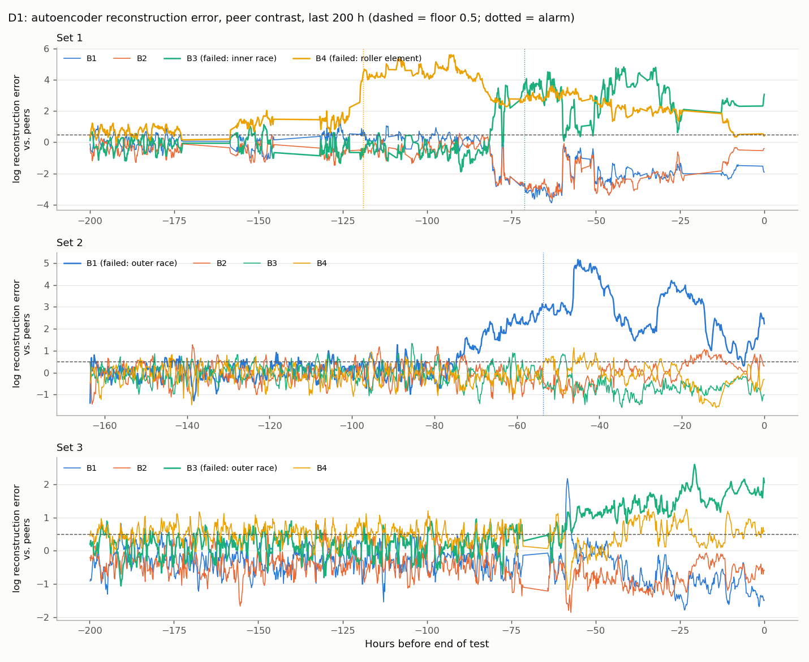
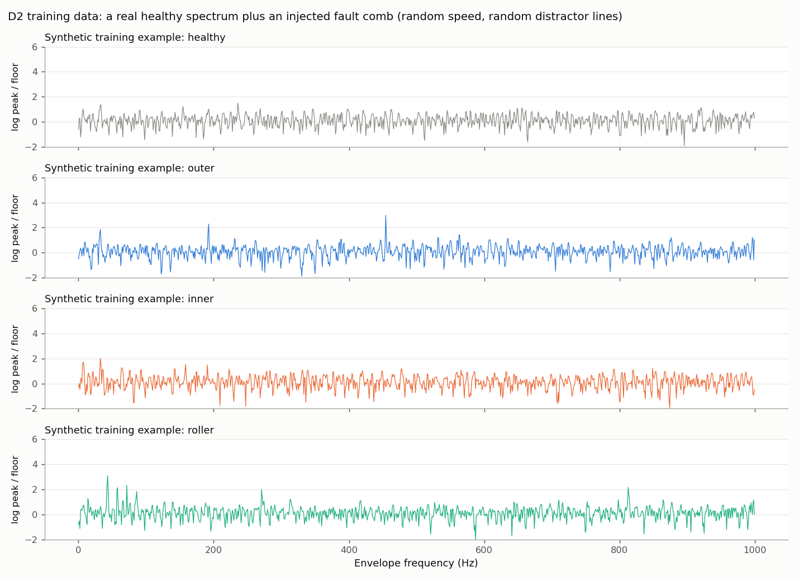
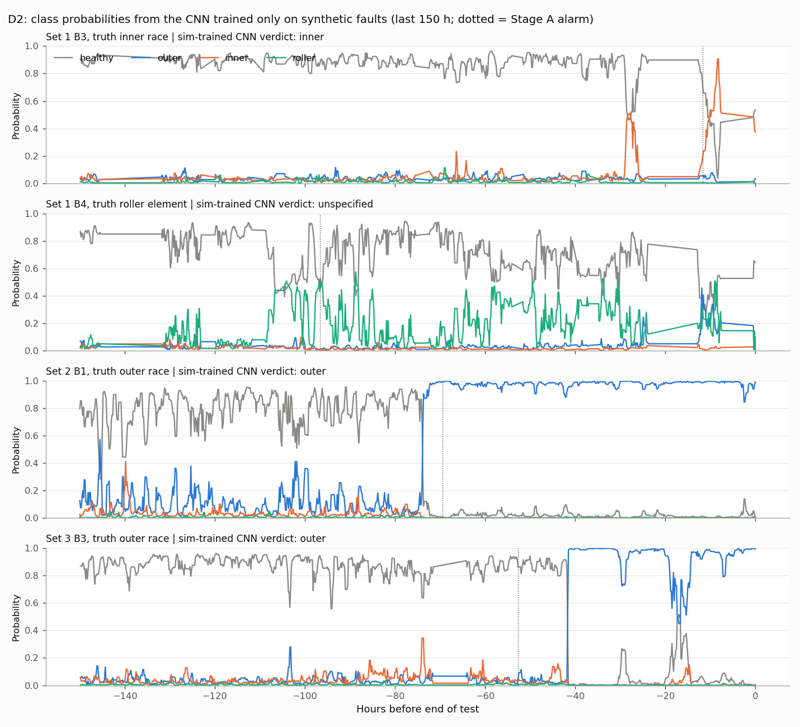

# Finding a Failing Bearing Before It Breaks, Explained Simply

> **How this document is written.** It follows the *Feynman technique*: explain every idea in plain words first, use an everyday comparison, and only then add the exact technical version. If a sentence still needs an expert to understand it, that part has not been explained well enough yet. Every abbreviation is spelled out the first time it appears and again in the table below.

---

## Abbreviations used in this document

| Short form | Full name | What it means in plain words |
| --- | --- | --- |
| **NASA** | National Aeronautics and Space Administration | The US space agency. Its data repository hosts the dataset we use. |
| **IMS** | Center for Intelligent Maintenance Systems (University of Cincinnati) | The lab that ran the bearing experiment and recorded the data. |
| **AI** / **ML** | Artificial Intelligence / Machine Learning | Computer methods that learn patterns from data. |
| **RUL** | Remaining Useful Life | How long a part can keep working before it fails (the topic of Part II). |
| **B1, B2, B3, B4** | Bearing 1, 2, 3, 4 | The four bearings on the test machine, numbered along the shaft. |
| **Hz** | Hertz | "Times per second". 230 Hz = something happens 230 times every second. |
| **kHz** | kilohertz | 1,000 Hz. 20 kHz = 20,000 times per second. |
| **ms** | millisecond | One thousandth of a second. |
| **rpm** | revolutions per minute | How many full turns the shaft makes in one minute. |
| **g** | standard gravity | Unit of acceleration (vibration strength). 1 g = the pull of Earth's gravity. |
| **RMS** | Root Mean Square | The average "strength" or energy of a vibration signal. Louder vibration = higher RMS. |
| **FFT** | Fast Fourier Transform | A math tool that splits a signal into the frequencies (rhythms) it is made of. |
| **BPFO** | Ball Pass Frequency, Outer race | How many times per second a rolling element passes one spot on the outer ring. |
| **BPFI** | Ball Pass Frequency, Inner race | The same, for one spot on the inner ring. |
| **BSF** | Ball Spin Frequency | How many times per second a rolling element spins around its own axis. |
| **2BSF** | Two times the Ball Spin Frequency | A damaged roller hits *both* rings once per spin, so its rhythm is 2 × BSF. |
| **FTF** | Fundamental Train Frequency | How many times per second the cage (the part holding the rollers) goes around. |
| **HI** | Health Index | One number that tracks how much a bearing's vibration has grown. |
| **FEI** | Fault Evidence Index | Our score for how strongly a specific fault's rhythm is present. |
| **sd** | standard deviation | How much a number normally wobbles around its average. |
| **MAD** | Median Absolute Deviation | A version of standard deviation that is not fooled by a few extreme values. |
| **z** (z-score) | standardised score | "How many normal wobbles away from normal". z = 5 means far outside normal. |
| **log** | logarithm | A way to measure growth as ratios: log(2) means "doubled", whatever the starting size. |
| **x / y** | horizontal / vertical axis | In set 1, each bearing had two sensors, one per direction. |
| **DL** | Deep Learning | Machine learning with neural networks made of many stacked layers. |
| **AE** | Autoencoder | A network trained to copy its input through a narrow "bottleneck"; it copies well only what it has seen before. |
| **CNN** | Convolutional Neural Network | A network that slides small pattern detectors along the input, good at finding peaks wherever they sit. |
| **1D** | one-dimensional | The input is a single line of numbers (one spectrum), not an image. |
| **LORO** | Leave-One-Run-Out | Testing on one failed run while training only on the others, so the test run is never seen in training. |
| **Sim-to-real** | simulation to real | Train on simulated (synthetic) examples, then use the model on real data. |

---

## 1. Problem statement

### 1.1 What is a bearing?

Think of a skateboard wheel. Inside it is a small ring of steel balls that lets the wheel spin smoothly around the axle. That is a **rolling-element bearing**. It has four parts:

| Part | Plain description |
| --- | --- |
| **Outer race** | The outer steel ring. It usually stays still, held in the machine's housing. |
| **Inner race** | The inner steel ring. It sits on the shaft and turns with it. |
| **Rolling elements** | The balls or rollers between the two rings. |
| **Cage** | A frame that keeps the rolling elements evenly spaced. |

Nearly every rotating machine in a smart factory has bearings: motors, pumps, fans, conveyors and machine-tool spindles. When a bearing breaks, the machine stops, and the shaft and housing around it can be damaged too.

### 1.2 What we want to know

A good diagnosis system should answer three questions using only vibration sensors:

1. **When** did the bearing stop being healthy? (*detection*)
2. **Where** is the problem: which bearing, if the machine has several? (*localization*)
3. **What** is broken: the outer race, the inner race, or a rolling element? (*identification*)

### 1.3 Why this is hard

- **Nobody breaks machines on purpose.** So there are very few recorded examples of real faults to learn from. Our method must work **without labelled fault data**.
- **The machine's real speed is not exactly the nameplate speed.** The textbook fault rhythms depend on speed, so they are slightly off on a real machine.
- **Sensors hear their neighbours.** When one bearing on a shaft is damaged, the sensors on the other bearings also pick up its vibration.

---

## 2. The data

We use the **NASA / IMS bearing dataset**. Four bearings (model Rexnord ZA-2115) sit on one shaft that turns at a nominal 2,000 rpm under a heavy constant load. Accelerometers (vibration sensors) on each bearing housing recorded a **1-second snapshot every 10 minutes**: 20,480 measurements at 20 kHz. The test ran until a bearing failed.

| Test | Snapshots | Duration | Sensors | Bearing that failed | What broke |
| --- | --- | --- | --- | --- | --- |
| Set 1 | 2,156 | 828 hours | 8 (x and y on each bearing) | B3 | Inner race |
| Set 1 | | | | B4 | Rolling element |
| Set 2 | 984 | 164 hours | 4 (one per bearing) | B1 | Outer race |
| Set 3 | 6,324 | 1,073 hours | 4 (one per bearing) | B3 | Outer race |

So we have **4 failed bearings** to find, and **8 bearings that stayed healthy**, which must *not* be flagged.

---

## 3. The key idea: a damaged bearing "clicks" with a rhythm

### 3.1 The simple version

Imagine a small pebble stuck in your bicycle tyre. Every time the wheel turns, you hear *tick*. If you count the ticks per second, you know how fast the wheel turns, and you know the noise comes from **the tyre**, not the chain.

A crack in a bearing works the same way. Every time a rolling element rolls over the crack, there is a tiny impact, a *click*. The **number of clicks per second depends on where the crack is**, because each part of the bearing moves at a different speed:

| Where the damage is | Its rhythm | At 2,000 rpm | Why |
| --- | --- | --- | --- |
| Outer race | BPFO | 236.4 Hz | The outer ring is still; the rolling elements pass the crack one after another. |
| Inner race | BPFI | 296.9 Hz | The inner ring spins with the shaft, so the crack meets the rolling elements more often. |
| Rolling element | 2BSF | 279.8 Hz | The damaged roller spins and touches the outer and inner ring once each per spin. |
| Cage | FTF | 14.8 Hz | The cage goes around slowly, carrying the rollers with it. |

So: **find the rhythm, and you know what is broken.**

### 3.2 What it looks like in real data


*Top row:* the raw vibration. The healthy bearing (left) is just noise. The failing bearing (right) shows sharp spikes about every 4.3 ms, i.e. about 230 times per second.

*Bottom row:* the **envelope spectrum**, which is a "rhythm detector":

1. **Envelope.** Trace the outline of the spikes, like drawing a line over the tops of mountains. This keeps *how often* the clicks happen and throws away the fast ringing inside each click.
2. **Spectrum.** Use the FFT (Fast Fourier Transform) to ask "which rhythms are in this outline?". Each repeating rhythm becomes a sharp peak.

The failing bearing shows peaks at 230, 461 and 692 Hz (one rhythm and its multiples). That is the outer-race rhythm. The healthy bearing has no peaks there.

---

## 4. The usual method, and where it trips

The standard approach (and our first attempt) is:

1. Filter the signal to a **fixed** frequency range of 1–9 kHz (where the clicks usually ring).
2. Compute the envelope spectrum.
3. Read the peak height at the **textbook** rhythms (236.4, 296.9, 279.8 Hz).
4. Compare with the bearing's **own early (healthy) data**. The rhythm that grew the most names the fault.

It trips in four places:

| Problem | Simple explanation | What goes wrong |
| --- | --- | --- |
| **Fixed filter band** | Like listening to one fixed radio station when the song moves between stations. | The click's ringing frequency differs per sensor and changes as damage grows. A wide fixed band mixes it with noise. |
| **Textbook rhythms** | Like looking for a friend at seat 236 when they sit at seat 230. | The real machine runs about 2.5% slower, so the real peaks sit beside where we look. |
| **Raw peak heights** | When the whole bearing gets louder, *every* peak gets taller. | All three fault scores rise together, so "the tallest one" is almost random. |
| **Compare with own early data** | Like checking if someone is sick by comparing with yesterday, when they were already sick yesterday. | If the fault is already there at the start, it becomes part of "normal" and is never seen. |

---

## 5. What we found in the data first

Before designing anything, we looked at the real spectra. Three findings shaped the whole method.

**Finding 1: the machine runs about 2.5% slow.** The outer-race peak sits at 230 Hz, not 236.4 Hz. The real speed is about 1,950 rpm, not 2,000 rpm.

**Finding 2: every sensor hears the broken bearing.** The four bearings share one shaft and housing. In set 3, the healthy B4 sensor showed the outer-race rhythm as strongly as the broken B3 sensor. So the rhythm tells us **what** is broken, but not **which bearing**.

**Finding 3: some faults are visible from the very beginning.** Set 2 B1's outer-race rhythm is visible in its first hours. Set 1 B4's cage rhythm is visible 594 hours before failure. Comparing these bearings with "their own healthy start" hides the fault.

What *does* point to the right bearing? **Loudness.** The broken bearing's vibration energy (RMS, Root Mean Square) grows faster than its neighbours'.

---

## 6. The proposed method

### 6.1 The big picture: two detectives

We split the job between two "detectives", because they need different clues:

- **Detective A, the loudness detective**, answers *where* and *when*. Loudness differs between bearings, so it can point at the right one.
- **Detective B, the rhythm detective**, answers *what*. Rhythm is the same on every sensor, so it identifies the fault type reliably even when sensors hear each other.



### 6.2 Stage A: where and when (the loudness detective)

**Simple version.** Imagine a classroom where everyone talks. You want to find the one student whose voice is *growing*. If the whole class gets louder (say, the teacher left the room), that does not count. So you compare each student with the rest of the class.

**Step A1: Health Index (HI).** How much louder is this bearing than at its own healthy start (the first 20% of the test)?

$$HI_b(t) = \log \frac{RMS_b(t)}{\text{median RMS of bearing } b \text{ in its healthy period}}$$

Here *b* is the bearing and *t* is the time. The logarithm turns growth into a ratio: log(2) means "twice as loud".

**Step A2: Peer contrast.** Subtract the typical growth of the *other* bearings at the same moment. This cancels anything that affects the whole machine: load, temperature, or vibration travelling from a neighbour.

$$C_b(t) = HI_b(t) - \text{median of } HI \text{ of the other bearings at time } t$$

**Step A3: Alarm.** Raise an alarm when the contrast stays above its limit for 6 snapshots in a row (about 1 hour), so a single bump is ignored. The limit is the larger of:

- 8 × the normal wobble of C during the healthy period (measured with the MAD, Median Absolute Deviation), or
- 0.15, which means about 16% more energy than the neighbours.

### 6.3 Stage B: what (the rhythm detective)

**Step B1: Tune the radio (adaptive band).** Clicks make the bearing housing "ring" at some frequency, like a bell. That frequency differs per sensor. We try 28 frequency bands and keep the one where the rhythm peaks stand out most sharply. Our first try picked the band with the biggest single spike, but it got fooled by random knocks. Choosing by "sharpest *repeating* rhythm" fixed that.

**Step B2: Measure peaks against the local noise (whitening).** A 1.8 m person stands out among children, but not among basketball players. So each peak is measured **relative to the noise around it** (peak ÷ running median over 20 Hz). A loud machine no longer makes every peak look important.

**Step B3: Slide the ruler (rhythm combs with speed search).** A fault rhythm is not one peak but a *comb*: the main rhythm plus its multiples (1×, 2×, 3×). We keep the comb's **shape** fixed and slide it slightly, between 95% and 101% of the nominal speed, until it fits the peaks best. This fixes Finding 1.

| Comb | Lines in the comb | Why these lines |
| --- | --- | --- |
| Outer race | 1×, 2×, 3× BPFO | The outer ring is still, so the clicks are evenly spaced. |
| Inner race | 1×, 2×, 3× BPFI, plus side peaks at BPFI ± shaft speed | The crack turns with the shaft, so its clicks get louder and softer once per turn. That creates side peaks. |
| Rolling element | 1×, 2×, 3× 2BSF, plus 1× to 4× FTF | The broken roller travels with the cage, so its clicks repeat at the cage rhythm. |

$$S_d = \max_{\text{speed}} \; \text{weighted average of } \log(\text{peak / noise}) \text{ over the comb's lines}$$

*d* is the defect type (outer, inner, roller); *S* is its comb score.

**Step B4: Compare with all healthy bearings (FEI, Fault Evidence Index).** Instead of comparing a bearing with its own start (which fails, see Finding 3), we compare it with the healthy period of **all sensors** in the same test. They share the shaft, speed and load, so they are a fair "normal".

$$FEI_d = \frac{S_d - \text{median of } S_d \text{ in all healthy data}}{1.4826 \times MAD}$$

This is a robust z-score: FEI = 5 means "5 normal wobbles above normal". The factor 1.4826 makes MAD comparable to the standard deviation (sd).

**Step B5: Verdict.** Once Stage A raises an alarm on a bearing, we average each fault's FEI from that moment onward. The highest one is the diagnosis. If none reaches 1, the answer is "unspecified": the method refuses to guess.

---

## 7. Results

### 7.1 Detection: did we find the right bearing, in time?


*How to read it:* each line is one bearing's energy growth compared with its neighbours. The thick line is the bearing that failed. Dotted vertical lines mark alarms; the dashed horizontal line is the 0.15 limit.

| Bearing | Truth | Alarm raised (hours before the end) | Our verdict |
| --- | --- | --- | --- |
| Set 1 B4 | Rolling element | 96.7 | Rolling element ✔ |
| Set 2 B1 | Outer race | 69.5 | Outer race ✔ |
| Set 3 B3 | Outer race | 52.7 | Outer race ✔ |
| Set 1 B3 | Inner race | 11.7 | Inner race ✔ |
| Set 3 B4 | Healthy | 728.1 (short bump) | Unspecified (refused to name a fault) |
| Set 2 B4 | Healthy | 3.7 | Outer race ✘ (picked up its dying neighbour) |
| The other 6 bearings | Healthy | No alarm | Healthy ✔ |

- **All 4 failures found**, a median of **61 hours** before the end of the test.
- **2 of 8 healthy bearings raised a false alarm.** Without the peer contrast (comparing only with its own start), 7 of 8 healthy bearings raised false alarms and one failure was missed.

### 7.2 Identification: did we name the right fault?


*How to read it:* the grey line is the rhythm spectrum. Solid coloured lines show where the **true** fault's comb should be; dashed lines show the other fault types. In every case, the solid lines land on peaks:

- **Set 2 B1 and Set 3 B3 (outer race):** clean peaks at about 230, 461 and 692 Hz.
- **Set 1 B3 (inner race):** inner-race peaks with their side peaks.
- **Set 1 B4 (rolling element):** a comb at the cage rhythm (about 14.4 Hz and multiples), already 594 hours before the end.

Both our method and the usual method named all 4 fault types correctly. So we also measured **how confident** each one was, using the **separation**:

> **Separation** = the true fault's evidence ÷ the strongest *wrong* fault's evidence.
> 1.0 = a coin flip (true and wrong look the same). Higher = a clear, trustworthy answer.

| Failed bearing | Usual method (fixed band) | Proposed method |
| --- | --- | --- |
| Set 2 B1, outer race | 1.88 | **50.19** |
| Set 3 B3, outer race | 1.03 (coin flip) | **9.86** |
| Set 1 B3, inner race | 2.50 | **3.86** |
| Set 1 B4, rolling element | 1.03 (coin flip) | **2.68** |

The usual method was right twice **by luck** (a 3% margin). The proposed method's weakest case still separates the true fault by 2.7×.



*How to read it:* left column = proposed method, right column = usual method; each colour is one fault type. On the left, one colour clearly rises above the others. On the right, all three colours rise together, because the whole bearing just got louder.

### 7.3 Which ingredient matters? (remove one at a time)

| Version | Faults named correctly | Worst separation |
| --- | --- | --- |
| **Full proposed method** | **4 / 4** | **2.68** |
| Without the speed search (textbook rhythms only) | 1 / 4 | 0.31 |
| Compare with own start instead of all healthy bearings | 3 / 4 | 0.28 |
| Usual method (fixed band, textbook rhythms, raw peaks) | 4 / 4 | 1.03 |

- **Without the speed search, the method is almost blind.** The textbook rhythms miss the real peaks by 6–18 Hz. Only the rolling-element fault survives, because its cage rhythm is so slow (about 14 Hz) that a 2.5% error shifts it by less than 1.5 Hz.
- **Comparing with its own start loses Set 1 B4**, because its cage rhythm was already there at the start and counted as "normal".

---

## 8. A deep-learning alternative

### 8.1 Can a neural network learn this by itself?

**Simple version.** A neural network learns by looking at many examples, like a child learning to recognise dogs from thousands of photos. Here we have a problem: the whole dataset contains **one** inner-race failure and **one** rolling-element failure. That is like teaching a child "zebra" from a single photo, and then testing on that same photo being hidden.

So we tried three designs. All of them start from **features** (numbers computed from the signal), then hand them to a network:

| Design | Input features | What the network does | Fault labels used |
| --- | --- | --- | --- |
| **D1: Autoencoder (AE)** | 16 condition numbers per snapshot (RMS, kurtosis, crest, band energies, envelope amplitudes) | Learns to copy *healthy* snapshots. A failing bearing is copied badly, so its copy error rises. | None |
| **D2: Sim-to-real CNN** | The whitened envelope spectrum (0-1000 Hz, 1,024 numbers) | A 1D CNN (Convolutional Neural Network) says healthy / outer / inner / roller. Trained only on **synthetic** faults. | None (simulated) |
| **D3: Supervised CNN** | The same spectrum | The same CNN, trained on **real** fault snapshots with LORO (Leave-One-Run-Out) testing. | Real |

### 8.2 D1: the autoencoder (where and when)

**Simple version.** Imagine a student who has only ever practised copying healthy heartbeats. Give them a healthy heartbeat and the copy is perfect. Give them an irregular one and the copy is clumsy. The clumsiness is the alarm.

The network squeezes 16 numbers into 4 and expands them back. It is trained only on the healthy first 20% of every bearing. Its copy error then becomes a health index, and we use the **same** "compare with the neighbours" alarm rule as Stage A (section 6.2).



| Detection method | Failures detected | False alarms (healthy bearings) | Median warning |
| --- | --- | --- | --- |
| Stage A (loudness vs neighbours) | 4 / 4 | 2 / 8 | 61 h |
| **D1 autoencoder** | 3 / 4 | **0 / 8** | **71 h** |

The autoencoder warned about the set 1 inner-race fault **71 hours** early (Stage A: 12 hours) and raised no false alarms. It missed set 3 B3: the error does rise, but that bearing's healthy period is noisy, so the alarm limit ended up too high.

### 8.3 D2: train on simulated faults (what)

**Simple version.** Pilots train in flight simulators because real emergencies are rare. We do the same: we take **real healthy spectra** and **paint a fault's rhythm on top**, following the physics of section 3. Each fake example gets a random speed (95-101% of nominal), random peak heights, and random "distractor" peaks so the network cannot cheat.



Two safety rules keep the test fair:

- The network **never sees a real fault** during training.
- The healthy backgrounds come only from the **other two tests**, so the network has never seen any data from the machine run it is tested on.

On fresh synthetic examples the network is right 89-93% of the time. On the real failures:



*How to read it:* each line is the network's confidence in one class. On set 2 B1 and set 3 B3 the blue "outer" line jumps to almost 1. On set 1 B3 the orange "inner" line rises at the end. On set 1 B4 the green "roller" line rises but rarely passes 0.5.

### 8.4 Results: physics vs. deep learning

| Identification method | Fault types correct | Snapshot accuracy, last 48 h | Why it ends up there |
| --- | --- | --- | --- |
| **Stage B: physics combs** (proposed) | **4 / 4** | **0.61** | Knows every fault's rhythm in advance. |
| **D2: CNN trained on simulated faults** | 3 / 4 | 0.51 | Outer and inner right; rolling element "unspecified" (roller was its top guess, but too weak to name). No fault ever called on a healthy bearing. |
| **D3: CNN trained on real labels** | 2 / 4 | 0.45 | Only outer race right. When the inner or roller run is held out, that fault type has **no** training example left, so the network cannot name it. |

**What this teaches:**

1. **Deep learning needs examples.** With 4 failures, a network trained on real labels (D3) simply cannot learn the rare fault types.
2. **Physics can create the examples.** Simulating faults on top of real healthy data (D2) recovers most of the performance without a single real fault label.
3. **For detection, the autoencoder is a real alternative.** It gave earlier warnings and no false alarms, at the cost of one missed failure.
4. A natural combined system: **autoencoder for detection**, then **physics combs and the sim-trained CNN agreeing** on the fault type.

---

## 9. Honest limitations

- **Only 4 failures.** The limits (8 × wobble, 0.15, FEI 1) were chosen while looking at the same data. Treat the numbers as a case study, not a proven accuracy.
- **2 false alarms out of 8 healthy bearings.** One came during the neighbour's final breakdown and copied its fault label.
- **The inner-race fault shows up late.** Set 1 B3's rhythm appears only in the last ~12 hours, leaving little time to act.
- **Speed must be roughly constant during each 1-second snapshot.** A machine that speeds up and slows down would need a speed sensor (tachometer).
- **Peer contrast needs peers.** It assumes several similar bearings on one machine, and it weakens if several fail at the same time.
- **The deep-learning results rest on the same 4 failures.** The autoencoder alarm floor (0.5) and the "unspecified" threshold (0.3) were also chosen on this data.

---

## 10. The whole thing in five sentences (the Feynman check)

1. A cracked bearing clicks, and the number of clicks per second tells you which part is cracked.
2. On a real machine the speed is a little off, and every sensor hears every bearing, so the textbook method is often right only by luck.
3. We use **loudness compared with the neighbouring bearings** to decide *which* bearing is failing and *when* it started.
4. We use **the click rhythm**, measured against the local noise, with a ruler slid to the real speed and compared with all healthy bearings, to decide *what* is broken.
5. On the IMS data this found all 4 failures (median 61 hours early) and named every fault type with a clear margin (at least 2.7×, versus 1.03× for the usual method).

*Bonus sentence:* deep learning cannot learn faults from 4 examples, but a network trained on **simulated** faults reached 3 of 4, and an autoencoder gave earlier, cleaner alarms.

---

## Appendix: how to reproduce

```bash
python pipeline/features.py        # basic features (used for RMS and the usual method)
python pipeline/diag_features.py   # rhythm-comb scores for every snapshot (~3 min on 16 cores)
python pipeline/diagnosis.py       # Stage A + Stage B, comparison tables and figures
python pipeline/explain_figure.py  # the healthy-vs-failing teaching figure (section 3)
python pipeline/dl_spectra.py      # envelope spectra for the deep-learning variant (~3 min)
python pipeline/dl_diagnosis.py    # autoencoder + CNNs (section 8; ~70 min on CPU)
```

All figures are written to `pipeline/outputs/`.
